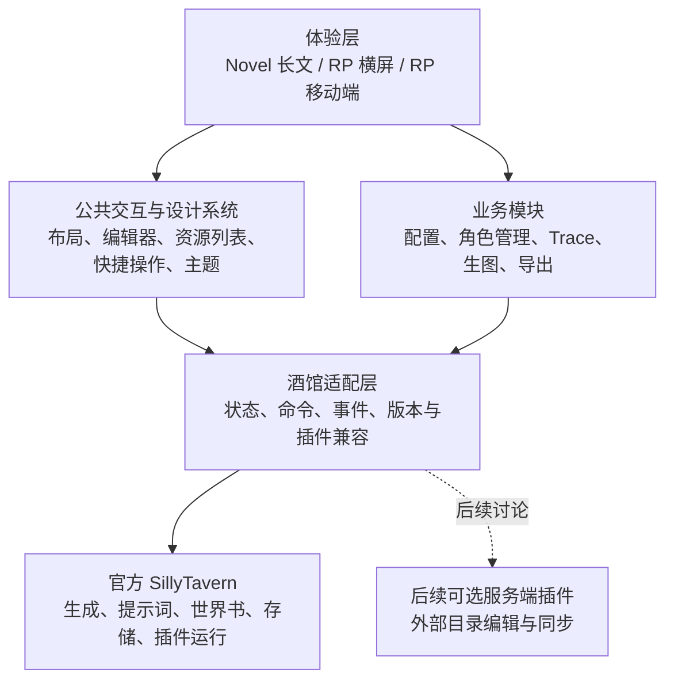

# SillyTavern 插件化工作台：总体架构

## 1. 总体方向

采用 **“官方 SillyTavern 运行时 + 新工作台插件 + 兼容适配层”**。

官方酒馆继续负责模型调用、提示词组装、世界书、角色卡、聊天记录和插件运行；新工作台负责页面布局、编辑体验、操作入口和轻量 Trace。

2026-10-09 更新：横屏 Novel 与 RP 已接入同一工作台，RP 主要替换主页布局和原生对话的展示方式，复用资源编辑、独立设置、原生输入和生成链路。PWA Novel、PWA RP 后续接入。四种场景共用底层能力与数据，已确认的布局保存在 `docs/design/`。

官方扩展机制允许使用 React/Vue、访问页面及酒馆上下文，适合承载这一方向；官方也建议优先使用 `getContext()`，减少对内部模块的直接依赖。[官方扩展文档](https://docs.sillytavern.app/for-contributors/writing-extensions/)

总体架构是开发基线。横屏首版实现及验证结果见 [第二阶段报告](../stage-2-report.md)，阶段一固定的官方运行时保持不变。

## 2. 分层与数据边界

### 工作台与公共能力

- 使用 TypeScript 与组件化前端框架构建，打包为酒馆前端扩展；默认采用 React。
- 对用户提供一个工作台插件，内部按模块拆分、按需加载，避免每个功能各自建立设置页和交互规则。
- 公共层统一提供布局容器、抽屉、编辑器、列表、搜索筛选、反馈、快捷键和操作注册机制。
- 同一操作可出现在按钮、快捷键、命令面板和移动端工具栏中，共用业务逻辑。

### 酒馆适配层

- 所有模块通过适配层读取状态、执行操作和订阅事件，避免各页面分别访问酒馆内部实现。
- 优先使用官方上下文和事件；必要的内部接口或 DOM 依赖集中封装，按版本检测。
- 共用酒馆生成与消息格式化链路，保留正则、宏、脚本和插件处理顺序。
- 适配失败时提供原生界面入口；插件关闭后仍能正常使用原酒馆。

### 数据与接口

- **酒馆原有数据保持为主数据源**：角色卡、聊天、预设和世界书沿用原格式，保留未知扩展字段。
- 插件仅增加布局偏好、连接分组、绑定关系、快捷操作配置等附加元数据。
- UI 状态可以缓存，业务修改通过酒馆既有保存路径完成，避免维护两套互相覆盖的数据。
- 新增接口限定在插件内部：宿主适配、操作注册、布局扩展和请求记录；第一版不增加必需的服务端 API。
- 外部目录编辑后续单独讨论。若实施，通过服务端插件承接文件访问；官方提供独立的服务端插件机制。[服务端插件文档](https://docs.sillytavern.app/for-contributors/server-plugins/)

## 3. 布局与审美架构

**审美作为每个模块的验收项，与功能一起设计。**

布局由“使用模式 × 设备形态”决定，不能只把桌面页面缩窄。

| 场景 | 布局方向 | 核心体验 |
|---|---|---|
| Novel · 横屏 | 长文阅读与编辑工作区，可收纳的导航和辅助栏 | 舒适行宽、排版层级、长文本编辑、连续阅读 |
| Novel · PWA | 单列阅读，全屏编辑器，工具按需展开 | 输入框最大化、长文滚动、键盘弹出后仍能编辑 |
| RP · 横屏 | galgame 式舞台、角色与背景、对话区域 | 内容突出、控制区可隐藏、历史记录随时可达 |
| RP · PWA | 拟真聊天布局、底部输入、侧滑抽屉 | 快速短句交互、单手操作、沉浸阅读 |

公共设计原则：

- 建立统一的字体、间距、色彩、层级、圆角和动效规范；模式之间保持一致的操作语言。
- 内容区、编辑区、配置区明确区分，输入框有清晰边界与焦点状态。
- 高频能力直接可达；低频配置进入独立管理页面，保留高级定制入口。
- 横屏侧栏支持收纳和隐藏；移动端默认隐藏，同时提供手势与按钮入口，避开系统返回手势。
- 可点击区域按触屏标准设计，主要控件至少提供约 44px 的触达范围。
- 动效优先服务于展开、切换与状态反馈，并支持减少动态效果。
- 背景、角色立绘、主题等作为可选表现层；无对应素材时仍保持完整、好看的布局。

每个模块开发前先交付可交互布局原型，验证真实长文本、复杂配置和移动端键盘场景，通过设计评审后再实现。具体配色、组件样式和页面细节留到模块设计阶段。

## 4. 功能模块边界

| 模块 | 架构职责 |
|---|---|
| **聊天与编辑器** | 共用 Markdown 文本编辑与预览能力；支持长文编辑、PWA 最大化、草稿保留和常用工具入口；保留原始文本，避免编辑过程破坏 XML、宏和脚本内容。 |
| **连接与预设** | 按模型组织连接，提供直接切换和下一个连接操作；预设支持可选的模型／连接绑定；将日常选择、启用与完整编辑分开。 |
| **世界书** | 横屏采用“左侧世界书、右侧条目列表”；移动端采用列表与详情分级进入，保留选择上下文；完整编辑使用独立页面。 |
| **角色管理** | 提供搜索、标签筛选、批量选择、编辑和删除；沿用角色卡格式，支持操作前检查与必要的恢复措施。 |
| **轻量 Trace** | 关联一次生成与请求快照，展示发送内容、消息顺序、参数和可识别的提示词片段；结合可用事件展示世界书命中。 |
| **生图与图片编排** | 复用酒馆生图能力，独立管理生图提示词、结果与目标消息的关联；桌面支持拖放插入，移动端支持选择插入位置。 |
| **结构分析与导出** | 扫描聊天原文，识别 AI 回复中的 XML 块及重复结构；用户选择标签后预览提取结果，导出内容及关联图片，并保留消息来源。 |
| **性能与兼容** | 负责加载策略、性能测量、插件能力检测和原生界面回退；业务模块不各自修改全局加载链路。 |

连接、预设和世界书共用快捷操作体系。配置编辑以独立页面为主，目录同步不纳入第一版。

**Trace 的边界：**优先使用官方可用事件采集，必要时在适配层观察指定生成接口的请求，不改变请求或流式响应。浏览器发给酒馆服务端的内容，与服务端最终发给模型的内容可能存在差异，界面必须标明采集位置；不能把文本匹配推测成完整的世界书命中原因。记录默认有容量上限，排除认证信息。

**兼容的边界：**重点覆盖酒馆助手、正则、快捷回复、STscript 与原生生图链路；其他插件通过适配或原生界面回退使用。酒馆助手使用 iframe 执行脚本，消息渲染、节点生命周期和滚动优化必须纳入兼容测试。[酒馆助手仓库](https://github.com/N0VI028/JS-Slash-Runner)

## 5. 推进、验证与维护

### 开发顺序

1. **官方基线与技术验证**  
   拉取并固定官方稳定 release，建立原生运行基线；验证工作台挂载、原生回退、酒馆助手、请求采集和启动耗时。默认不修改核心。

2. **设计系统与工作台骨架**  
   先设计四种场景的整体布局，再实现导航、收纳、编辑器和操作入口，形成后续模块可复用的基础。

3. **高频配置与角色管理**  
   依次设计并实现连接／预设、世界书、角色管理，优先解决最频繁的选择、启用和编辑操作。

4. **增强模块**  
   按模块设计并实现 Trace、生图编排、结构分析与导出。

5. **发布与迁移**  
   完成兼容回归、性能对比和升级回退验证；项目稳定后，根据实际实现生成迁移 skill，覆盖安装、数据备份、插件检查、迁移验证与回退。

### 性能策略

先区分服务端启动、前端初始化、扩展加载和聊天渲染耗时，再决定优化位置。采用模块懒加载、延后非必要工作、减少重复渲染和大列表按需呈现；涉及消息 iframe 的优化单独验证。

“鸡尾酒”作为启动、聊天渲染和正则刷新优化的参考，先评估实现与兼容性，避免重复安装后多次拦截同一链路。[鸡尾酒仓库](https://github.com/Lianues/cocktail)

不预先承诺提速比例，也不把显示骨架屏等同于可用时间缩短。

### 验收与 release 维护

- **布局：**四种场景均验证长内容、空状态、错误状态、输入法、软键盘和横竖屏切换。
- **功能：**验证切换连接、预设绑定、世界书启用、角色删改、生成取消、图片插入及 XML／图片导出。
- **兼容：**确认重点插件可运行；关闭新工作台或进入原生界面后，数据和生成行为正常。
- **数据：**旧格式读写往返不丢字段；编辑、重新生成和切换回复后，图片与 Trace 关联正确。
- **性能：**同设备、同数据集比较冷启动、热启动、可交互时间、长聊天滚动及内存占用。
- **升级：**官方源码、插件源码和用户数据分别维护；固定已验证的 release 与插件版本，新 release 先在测试实例验证，再升级并保留回退路径。

第一版默认面向个人自托管使用，提供在线网页／PWA 体验；不引入独立小说项目系统、原生桌面壳、离线生成或目录双向同步。
